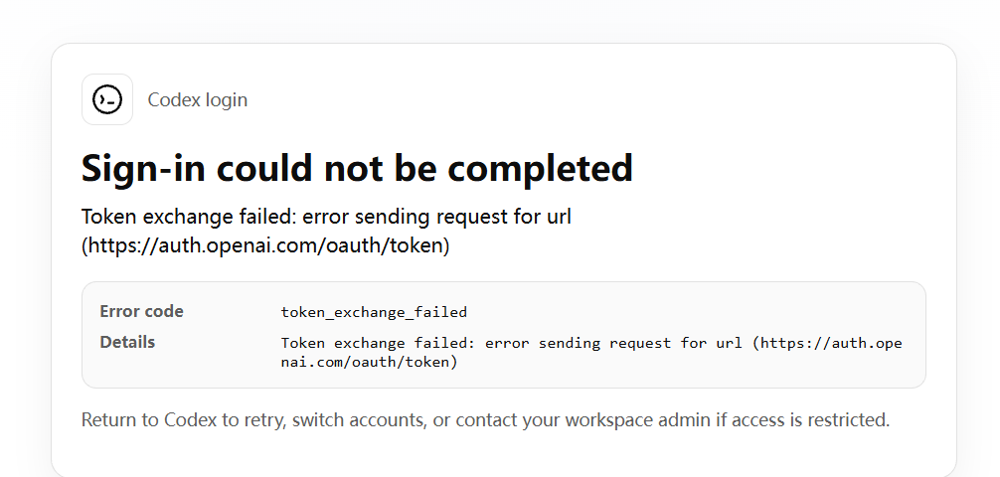
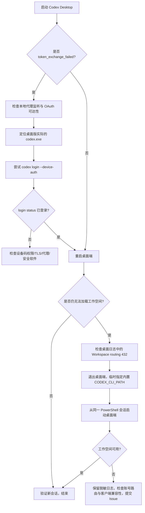

# Windows Codex 登录失败与工作空间加载失败：完整排查及修复实录

> **适用症状**：`token_exchange_failed`、`Token exchange failed: error sending request for url (https://auth.openai.com/oauth/token)`、`无法加载工作空间设置 / 请重试以继续聊天`、`Workspace routing is unavailable`、日志 `status=432`。
>
> **实测结果**：2026-11-23，在 Windows 11 的 Microsoft Store/MSIX 版 Codex 上，沿着 **CLI 设备码登录流程**恢复认证，再通过 **临时指定 MSIX 安装包内置 `codex.exe`，从同一 PowerShell 会话启动桌面应用**解决工作空间加载问题。**这是成功案例，不是对所有版本的通用保证，也尚未精确隔离单一根因。**
>
> **发布前说明**：下文路径中的 `<用户名>`、`<哈希目录>` 是占位符；`44100` 是本次实测本地代理端口，不是所有电脑的默认值。本文不包含任何登录令牌、账号标识或私人日志原文。




## 目录

- [1. TL;DR：先看最终有效的两阶段解决方案](#1-tldr先看最终有效的两阶段解决方案)
- [2. 复现环境、故障表现与范围](#2-复现环境故障表现与范围)
- [3. 第一阶段：解决 token_exchange_failed](#3-第一阶段解决-token_exchange_failed)
- [4. 第二阶段：解决工作空间设置加载失败与 432](#4-第二阶段解决工作空间设置加载失败与-432)
- [5. 如何正确解读诊断输出](#5-如何正确解读诊断输出)
- [6. 本次尝试过但没有单独解决问题的操作](#6-本次尝试过但没有单独解决问题的操作)
- [7. 一键脚本与自助诊断](#7-一键脚本与自助诊断)
- [8. 回滚、数据保护与安全](#8-回滚数据保护与安全)
- [9. FAQ 与问题分流](#9-faq-与问题分流)
- [10. 复现记录和关键证据](#10-复现记录和关键证据)
- [11. 官方资料与同类 Issue](#11-官方资料与同类-issue)
- [12. 适用性、限制与后续维护](#12-适用性限制与后续维护)

---

## 1. TL;DR：先看最终有效的两阶段解决方案

**如果你遇到的错误与两张截图一致，请按顺序进行：**

1. **先解决登录**。找到 Codex 桌面版实际使用的 CLI，执行 `login --device-auth`，直到 `login status` 显示 `Logged in using ChatGPT`。
2. **再解决工作空间**。如果已登录仍报“无法加载工作空间设置”，检查桌面日志是否有大量 `Workspace routing is unavailable`、`status=432`。彻底退出桌面应用后，将 **当前 MSIX 安装包中的** `app\resources\codex.exe` 指给当前 PowerShell 会话的 `CODEX_CLI_PATH`，再从同一会话启动 `app\ChatGPT.exe`。
3. **验证**：桌面端可进入主界面、工作空间提示消失，并能新建会话发送测试消息。不要只凭“能看到账号”认定完全修复。

### 最终成功使用的桌面启动方式

> **前提**：已完成 ChatGPT 登录；关闭所有旧 Codex 桌面实例；下方脚本仅设置当前 PowerShell 会话的变量。**不要用自己电脑里旧版或来源不明的外部 `codex.exe` 代替安装包内置的文件。**

```powershell
$pkg = Get-AppxPackage -Name 'OpenAI.Codex'
if (-not $pkg) { throw '未找到 OpenAI.Codex 应用包' }

$bundledCli = Join-Path $pkg.InstallLocation 'app\resources\codex.exe'
$desktopExe = Join-Path $pkg.InstallLocation 'app\ChatGPT.exe'

if (-not (Test-Path -LiteralPath $bundledCli)) { throw '未找到安装包内置 CLI' }
if (-not (Test-Path -LiteralPath $desktopExe)) { throw '未找到安装包内置桌面程序' }

# 确认已完全退出旧的桌面实例，避免旧进程继续使用原后端
Get-CimInstance Win32_Process |
  Where-Object { $_.Name -eq 'ChatGPT.exe' } |
  Select-Object ProcessId, Name, ExecutablePath

# 如上面仍有 Codex 桌面进程，请先在任务管理器正常退出，再继续
& $bundledCli --version
& $bundledCli login status

# ★ 核心：仅设置当前 PowerShell 会话，并从该会话启动桌面端
$env:CODEX_CLI_PATH = $bundledCli
Start-Process -FilePath $desktopExe
```

这段方法在本次案例中 **成功**。它改变了 **运行时选择** 和 **应用启动方式** 两个因素，因此不能严格证明错误百分之百源于某一份 `codex.exe` 的版本差异。该覆盖仅对当前 PowerShell 会话及其子进程有效，**以后从开始菜单正常启动不一定继续生效**。

如果希望复用而无需反复复制命令，请使用本仓库 [`scripts/02-Launch-Codex-BundledCLI.ps1`](scripts/02-Launch-Codex-BundledCLI.ps1)；仍需关闭现有桌面实例并由该脚本启动。

---

## 2. 复现环境、故障表现与范围

### 2.1 真实测试环境

| 项目 | 本次实测值 | 说明 |
|---|---|---|
| 日期 | 2026-11-23 | 后续应用更新可能改变行为 |
| 系统 | Windows 11 Professional Workstation，x64；系统内部版本 `10.0.26100` | 来自 `codex doctor` |
| 安装渠道 | Microsoft Store / MSIX | `Get-AppxPackage OpenAI.Codex` 可找到 |
| 桌面应用 | `OpenAI.Codex` `26.1117.4957.0` | 本次实际环境，不表示其他版本不受影响 |
| 已复制的 CLI 后端 | `codex-cli 0.171.0-alpha.13` | 位于用户目录的哈希子文件夹 |
| 真实运行后端路径形态 | `%LOCALAPPDATA%\OpenAI\Codex\bin\<哈希目录>\codex.exe` | 哈希随版本变化；不要写死 |
| MSIX 内置 CLI | `%ProgramFiles%\WindowsApps\<安装包目录>\app\resources\codex.exe` | 使用 `Get-AppxPackage` 动态获取 |
| 配置文件 | `%USERPROFILE%\.codex\config.toml` | `respect_system_proxy = true` |
| 凭据存储 | `%USERPROFILE%\.codex\auth.json`（文件模式） | **敏感文件，严禁公开** |
| 网络 | Windows 系统代理启用，本地 HTTP 代理监听 `127.0.0.1:44100` | 本机进程示例名称 `jgjs-core`；端口请按个人情况调整 |
| Tailscale / IPv6 | 曾参与网络排查 | **没有证据表明需要关闭 IPv6/Tailscale 才能解决此故障** |

### 2.2 两个连续但不同的故障阶段

**阶段 A：登录失败。** 浏览器授权操作结束后，Codex 显示：

```text
Sign-in could not be completed
Token exchange failed: error sending request for url
(https://auth.openai.com/oauth/token)
Error code: token_exchange_failed
```

**阶段 B：登录成功，但工作空间初始化失败。** 通过 CLI 授权后，`login status` 显示已登录，桌面端却显示：

```text
无法加载工作空间设置
请重试以继续聊天
```

后续扫描桌面日志，发现大量：

```text
sa_server_request_failed
errorMessage="Workspace routing is unavailable"
status=432
```

两类故障不能混为一谈：**登录凭据是否可用**、**桌面应用能否发现和加载工作空间路由**是不同检查项。

### 2.3 排障决策图



---

## 3. 第一阶段：解决 `token_exchange_failed`

### 3.1 首先区分“浏览器能上网”和“Codex 后端能联网”

浏览器可能遵循 Windows 系统代理，但 Codex CLI、Electron、Git 或其他子进程可能分别读取环境变量、系统代理或自身配置。因此，**浏览器访问 ChatGPT 正常，不证明 Codex 发起 Token 交换也正常**。

检查当前网络设置：

```powershell
# 当前 shell 的代理变量（打印前确认不含账号/密码）
Get-ChildItem Env: |
  Where-Object { $_.Name -match '^(HTTP|HTTPS|ALL|NO)_PROXY$' } |
  Format-Table Name, Value -AutoSize

# Windows 用户系统代理
Get-ItemProperty 'HKCU:\Software\Microsoft\Windows\CurrentVersion\Internet Settings' |
  Select-Object ProxyEnable, ProxyServer, AutoConfigURL

# WinHTTP 代理（可能与浏览器代理不同）
netsh winhttp show proxy

# 域名解析及直连 TCP 检测
Resolve-DnsName auth.openai.com -Type A
Test-NetConnection auth.openai.com -Port 443
```

本次实测起初发现：

```text
HTTP_PROXY / HTTPS_PROXY（当前会话）：未设置
Windows ProxyEnable：1
Windows ProxyServer：http=127.0.0.1:44100;https=127.0.0.1:44100
WinHTTP：直接访问（没有代理服务器）
DNS：解析到 IPv4 地址
TCP 443：TcpTestSucceeded=True
```

**解释**：`Test-NetConnection` 测的是 TCP 可达性，不能证明应用层的 OAuth Token 交换成功。WinHTTP 配置为空，也不能自动得出 Codex 一定“直连”。

### 3.2 验证代理是否真的监听

```powershell
# 将 44100 替换为自己代理软件实际监听的 HTTP/Mixed 代理端口
$port = 44100
$listener = Get-NetTCPConnection -LocalPort $port -State Listen -ErrorAction SilentlyContinue |
  Select-Object -First 1

if ($listener) {
    Get-Process -Id $listener.OwningProcess | Select-Object ProcessName, Id
} else {
    Write-Warning "端口 $port 没有监听，请检查代理软件及端口配置"
}
```

本次看到 `jgjs-core` 在 `44100` 正常监听。进程名是个人代理客户端相关进程，其他用户不必相同。

### 3.3 用明确指定的代理测试 OAuth 和 GitHub

以下请求使用**故意无效的授权参数**，不会完成登录，也不会发送用户凭据：

```powershell
$proxy = 'http://127.0.0.1:44100'  # 换成自己真实可用的 HTTP 代理

# OAuth：收到 HTTP 400 通常意味着服务已收到无效参数请求
curl.exe --proxy $proxy -sS -o NUL `
  -w "OAuth HTTP=%{http_code}`n" `
  --connect-timeout 8 --max-time 15 `
  -X POST 'https://auth.openai.com/oauth/token' `
  -H 'Content-Type: application/x-www-form-urlencoded' `
  --data 'grant_type=invalid_test'

# GitHub：通常期望 HTTP 200，但重定向/网络策略也可能影响结果
curl.exe --proxy $proxy -sS -o NUL `
  -w "GitHub HTTP=%{http_code}`n" `
  --connect-timeout 8 --max-time 15 `
  'https://github.com/'
```

本次实际结果：

```text
未经显式代理的一次 OAuth POST：HTTP 403
显式通过 127.0.0.1:44100：HTTP 400
同一代理访问 GitHub：首页 HTTP 200
```

**不可误读**：

- `HTTP 400` 是故意提交无效 `grant_type` 的预期响应，不是 OAuth 真实登录成功；只能证明代理链路和请求/响应基本可用。
- `HTTP 403` 也不等于账号被封禁；需要看响应正文、`cf-mitigated` 头、请求阶段，以及网络出口。
- 如果代理不支持 HTTP CONNECT，或其实只有 SOCKS 端口，不能直接套用 `http://127.0.0.1:<端口>` 的写法。

### 3.4 对齐 Windows 用户级代理（可选，不是此次独立最终修复）

在**实际代理端口已经验证**的前提下，可为之后启动的 Codex 进程设置用户级环境变量：

```powershell
$proxy = 'http://127.0.0.1:44100'  # 示例，请按实际端口替换

# 先备份，再修改
$names = @('HTTP_PROXY','HTTPS_PROXY','NO_PROXY')
$backup = @{}
foreach ($name in $names) {
    $backup[$name] = [Environment]::GetEnvironmentVariable($name, 'User')
}
$backup | Export-Clixml "$HOME\codex-proxy-backup.xml"

[Environment]::SetEnvironmentVariable('HTTP_PROXY', $proxy, 'User')
[Environment]::SetEnvironmentVariable('HTTPS_PROXY', $proxy, 'User')
[Environment]::SetEnvironmentVariable('NO_PROXY', 'localhost,127.0.0.1,::1', 'User')
```

修改后要**完全退出 Codex 并重新启动**；环境变量不会自动更新已经运行的子进程。用户级变量也可能影响其他程序，因此不建议盲目永久配置。请参阅 [回滚方法](#8-回滚数据保护与安全)。

### 3.5 检查 Codex 自身是否启用了系统代理功能（可选）

`%USERPROFILE%\.codex\config.toml`：

```toml
[features]
respect_system_proxy = true
```

如果文件中已存在 `[features]`，仅增加一行，**不要重复创建相同 TOML 表**。本次 CLI 检测结果：

```text
respect_system_proxy    experimental    true
system_proxy_fallback    stable          true
```

官方源码把 `respect_system_proxy` 标为**实验性功能**；其具体实现和默认行为可能随版本变化。**本次即使已开启该选项，GUI 普通 OAuth 登录仍失败**，所以它不是单独有效的修复步骤。

### 3.6 找到桌面版使用的真实 CLI：不用安装第二套

```powershell
# 查看正在运行的 codex.exe 的完整路径
Get-CimInstance Win32_Process |
  Where-Object { $_.Name -eq 'codex.exe' } |
  Select-Object ProcessId, Name, ExecutablePath

# 桌面版常见的“复制后端”位置
$binRoot = Join-Path $env:LOCALAPPDATA 'OpenAI\Codex\bin'
Get-ChildItem -LiteralPath $binRoot -Filter 'codex.exe' -File -Recurse `
  -ErrorAction SilentlyContinue |
  Select-Object FullName, LastWriteTime, Length

# 安装包自带 CLI 的位置（与用户目录复制后端不同）
$pkg = Get-AppxPackage -Name 'OpenAI.Codex'
$bundledCli = Join-Path $pkg.InstallLocation 'app\resources\codex.exe'
[PSCustomObject]@{
    Version = $pkg.Version
    InstallLocation = $pkg.InstallLocation
    BundledCliExists = Test-Path -LiteralPath $bundledCli
}
```

本次复制后端的路径形态：

```text
C:\Users\<用户名>\AppData\Local\OpenAI\Codex\bin\<哈希目录>\codex.exe
```

**哈希目录会随 Codex 更新而变化。** 不要将示例中的哈希目录直接复制到自己的电脑。

### 3.7 运行 CLI 诊断，识别“未登录”而不是误判 WebSocket

```powershell
$cli = (Get-CimInstance Win32_Process |
  Where-Object { $_.Name -eq 'codex.exe' -and $_.ExecutablePath } |
  Select-Object -First 1 -ExpandProperty ExecutablePath)

if (-not $cli) { throw '未找到正在运行的 codex.exe，请使用上一步定位文件路径' }

& $cli --version
& $cli login status
& $cli features list | Select-String 'respect_system_proxy|system_proxy_fallback'
& $cli doctor  # 若该版本不支持 doctor，可跳过
```

本次 `codex doctor` 的**有意义的实测结论**：

```text
codex-cli 0.171.0-alpha.13
Not logged in
config.toml parse: ok
respect system proxy: enabled
auth: no Codex credentials were found
ChatGPT inference URL reachable: HTTP 405
desktop assets CDN reachable: HTTP 200
Responses WebSocket handshake: HTTP 401; auth mode: none
SQLite state DB integrity: ok
```

因为 `auth mode: none`，此时的 WebSocket `401` **不足以证明代理、WebSocket 或账号有故障**。同样，`ripgrep` 缺失、MCP 变量未设置、会话索引瑕疵和 Defender 常规提醒并不自动等于本次登录失败的原因。

### 3.8 本次成功的登录修复：设备码授权

**请确认设备码登录在你的账户/工作区中可用**。Codex 官方文档支持此方式，它不依赖默认浏览器 OAuth 的本地回调。不要公开设备码或授权链接中的敏感参数。

先取得运行后端 CLI 路径（桌面端未启动时，也可以在 `%LOCALAPPDATA%\OpenAI\Codex\bin` 中寻找最近版本）：

```powershell
$binRoot = Join-Path $env:LOCALAPPDATA 'OpenAI\Codex\bin'
$cli = Get-ChildItem -LiteralPath $binRoot -Recurse -File -Filter 'codex.exe' `
  -ErrorAction SilentlyContinue |
  Sort-Object LastWriteTime -Descending |
  Select-Object -First 1 -ExpandProperty FullName

if (-not $cli) { throw '没有找到 CLI，请先按 3.6 节定位后端' }
& $cli login --help
& $cli login --device-auth
```

按终端提示在**官方网页**完成设备码授权，然后检查：

```powershell
& $cli login status

# 仅检查文件元数据，不输出认证文件的内容
$auth = Join-Path $HOME '.codex\auth.json'
if (Test-Path -LiteralPath $auth) {
    Get-Item -LiteralPath $auth | Select-Object Name, Length, LastWriteTime
} else {
    Write-Host '未发现 auth.json（可能使用了其他受支持的凭据存储方式）'
}
```

本次实际输出：

```text
Logged in using ChatGPT

auth.json   文件已创建（不公开内容）
```

**至此，阶段 A 的认证状态已确认恢复。** 原始聊天记录未包含设备码授权命令的成功回显，只包含后续 `Logged in using ChatGPT` 与认证文件已生成的证据；因此这里将其表述为“按照设备码登录步骤排障后验证已登录”，而非声称有完整的设备码请求抓包证明。 但桌面版随后出现阶段 B 的工作空间设置问题，因此还需要继续下一节。

> **安全提示**：Codex 官方文档明确指出，文件式认证缓存 `~/.codex/auth.json` 包含敏感凭据。**不要读取后贴到 Issue、不要上传 GitHub、不要通过聊天发送此文件**。即使文件只有几 KB，也应视为密码。

---

## 4. 第二阶段：解决工作空间设置加载失败与 432

### 4.1 先确认“已登录但 GUI 失败”

登录后可先运行：

```powershell
& $cli login status
```

如果是 `Logged in using ChatGPT`，但桌面端仍显示“无法加载工作空间设置”，不要立即执行 `logout`、删除 `auth.json` 或重装应用。该症状与 Token 交换阶段已经不同。

### 4.2 本次桌面日志实际存放位置

首先**不要假设**所有 Windows Codex 的日志都在 `%LOCALAPPDATA%\Codex\Logs`。本次真实情况：

| 日志目录 | 本次存在？ |
|---|---|
| `%LOCALAPPDATA%\Codex\Logs` | 否 |
| `%LOCALAPPDATA%\Packages\OpenAI.Codex_2p2nqsd0c76g0\LocalCache\Local\Codex\Logs` | 是 |

PowerShell：

```powershell
$roots = @(
  "$env:LOCALAPPDATA\Codex\Logs",
  "$env:LOCALAPPDATA\Packages\OpenAI.Codex_2p2nqsd0c76g0\LocalCache\Local\Codex\Logs"
)

foreach ($root in $roots) {
  [PSCustomObject]@{ Path = $root; Exists = (Test-Path -LiteralPath $root) }
}

$files = @(
  foreach ($root in $roots) {
    if (Test-Path -LiteralPath $root) {
      Get-ChildItem -LiteralPath $root -Recurse -File -Filter '*.log' `
        -ErrorAction SilentlyContinue
    }
  }
) | Where-Object { $_.Length -gt 0 } |
  Sort-Object LastWriteTime -Descending |
  Select-Object -First 20

$files | Select-Object -First 10 Name, LastWriteTime, Length |
  Format-Table -AutoSize
```

**排查过程中的一个真实坑**：我们曾错误地直接运行使用 `$root` 的日志扫描片段，却没有在当前 PowerShell 会话定义 `$root`，又加了 `-ErrorAction SilentlyContinue`，导致**表面上“没有匹配记录”，实际上没有读到日志**。上面的完整版会先明确路径。

### 4.3 提取工作空间路由错误（安全版，不输出原始日志）

```powershell
$pattern = 'Workspace routing|sa_server_request_failed|' +
           'cloudflare_challenge|ERR_PROXY_CONNECTION_FAILED|EXDEV'

$results = @(
  foreach ($file in $files) {
    foreach ($hit in @(Select-String -Path $file.FullName -Pattern $pattern `
                         -ErrorAction SilentlyContinue)) {
      $line = $hit.Line
      $type = if ($line -match 'Workspace routing') { 'Workspace Routing' }
              elseif ($line -match 'cloudflare_challenge') { 'Cloudflare' }
              elseif ($line -match 'ERR_PROXY_CONNECTION_FAILED') { 'Proxy' }
              elseif ($line -match 'EXDEV') { 'File System' }
              else { 'Request' }
      $status = '-'
      if ($line -match '(?i)(?:status|httpStatus)\s*[:=]\s*"?(\d{3})') {
        $status = $Matches[1]
      }
      [PSCustomObject]@{ Time = $file.LastWriteTime; Type=$type; Status=$status; Line=$hit.LineNumber }
    }
  }
)
$results | Select-Object -Last 40 | Format-Table -AutoSize
```

本次扫描到大量：

```text
Workspace Routing  432
Workspace Routing  432
Workspace Routing  432
...
Proxy Failure      -
```

**重要的证据边界**：`432` 是**桌面日志中记录的状态**；在没有原始 HTTP 响应、请求链路追踪的情况下，不能断定它必然是服务端返回的标准 HTTP 432，也不能据此断定 ChatGPT 账号存在封禁或订阅问题。官方仓库 Issue 中同样提醒要区分日志状态与真正的远端 HTTP 响应。

### 4.4 此前日志还有 `EXDEV`，但不能直接认定为根因

本次先前出现：

```text
Failed to persist global state
EXDEV: cross-device link not permitted, rename ...
Failed to initialize host Statsig identity
```

这说明桌面进程在更新部分应用状态文件时出现重命名错误。它可能与 Windows 打包应用的路径、重定向或文件操作相关，但**没有证据证明其直接导致 `token_exchange_failed` 或 432**。本次最终成功**未通过删除这些状态文件来实现**。

### 4.5 核心修复：切换到当前 MSIX 安装包内置的 CLI

这一节是**本次恢复桌面端的关键成功操作**。

**操作步骤：**

1. **完整退出** Codex 桌面版（必要时检查任务管理器；不要在工作进行中强制结束）。
2. 打开一个新的 PowerShell，运行下面的脚本。它动态识别 `OpenAI.Codex` 安装包，无需硬编码版本号、用户名或哈希目录。
3. 先确认 `& $bundledCli login status` 是 `Logged in using ChatGPT`。
4. 在**同一个 PowerShell 会话**设置 `$env:CODEX_CLI_PATH` 并执行 `Start-Process`。
5. 检查工作空间错误是否消失，以及是否能够发送真实测试消息。

```powershell
$pkg = Get-AppxPackage -Name 'OpenAI.Codex'
if (-not $pkg) { throw '没有安装 OpenAI.Codex MSIX 应用' }

$bundledCli = Join-Path $pkg.InstallLocation 'app\resources\codex.exe'
$desktopExe = Join-Path $pkg.InstallLocation 'app\ChatGPT.exe'

if (-not (Test-Path -LiteralPath $bundledCli)) { throw '内置 CLI 文件不存在' }
if (-not (Test-Path -LiteralPath $desktopExe)) { throw '桌面启动文件不存在' }

Write-Host "内置 CLI: $bundledCli"
& $bundledCli --version
& $bundledCli login status

# 如果桌面应用仍在运行，请先退出，不要让旧进程占用原运行时
Get-CimInstance Win32_Process |
  Where-Object { $_.Name -eq 'ChatGPT.exe' } |
  Select-Object ProcessId, ExecutablePath

# 确认已关闭后继续：
$env:CODEX_CLI_PATH = $bundledCli
Start-Process -FilePath $desktopExe
```

**本次确认：使用这一方法启动后，用户反馈“成功了”。** 这说明该次启动恢复了桌面应用的使用能力，**但不能仅凭一次成功就断言永久根治**。下一次正常启动、应用更新或配置变化后，仍可能需要再次尝试。

### 4.6 检查是否真正采用了内置运行时

如果希望验证实际进程，而不是只看设置的环境变量：

```powershell
Get-CimInstance Win32_Process |
  Where-Object { $_.Name -eq 'codex.exe' } |
  Select-Object ProcessId, ExecutablePath |
  Format-List
```

有的桌面构建会在日志中显示 `source=override`、`consumer=app-server`、`executablePath=...`；不同版本的日志格式可能不同。只设置环境变量，不确认进程和工作空间行为，不能视为有效验证。

### 4.7 为什么这种方法可能有效？哪些仍然未知？

**已知：**

- CLI 设备码授权成功，意味着同一机器至少有一条可行的账号授权路径。
- Codex CLI 能读取 ChatGPT 凭据；桌面端仍能出现独立的工作空间路由错误。
- 临时设置 `CODEX_CLI_PATH` 并从同一 PowerShell 会话启动 MSIX 内置桌面程序后，本次故障恢复。
- 官方仓库中存在类似成功案例：同样采用包内置 CLI + 同会话启动桌面应用。

**尚未被本次实验严格证明：**

- 默认复制后端与 MSIX 内置后端一定存在**版本不兼容**（本次没有受控比较两者的内部版本和差异）。
- `CODEX_CLI_PATH` 这一项单独就足以恢复（本次同时更改了启动方式）。
- 432 必然来自 OpenAI 远端服务器而非客户端本地路由层。
- `EXDEV`、IPv6、Tailscale 或回环豁免是最终修复的必要步骤。

**所以本文应称为“实测有效的临时恢复方案”，而不是“唯一根因已确诊”。**

---

## 5. 如何正确解读诊断输出

| 看到的结果 | 可以确定什么 | 不能据此推断什么 |
|---|---|---|
| `TcpTestSucceeded=True` | 可以与目标建立 TCP 连接 | OAuth/TLS/身份验证必然成功 |
| 无效 Token POST 返回 `400` | 某条代理链路可得到 HTTP 应用响应 | 已登录或 Token 一定有效 |
| 未使用显式代理时 `403` | 此请求被拒绝 | 账号被封禁；所有 OpenAI 接口不可用 |
| `auth.json` 存在 | 文件存在 | 登录凭据有效且桌面账号状态正常 |
| `Logged in using ChatGPT` | CLI 识别当前 ChatGPT 认证状态 | GUI 的所有工作空间接口均可用 |
| WebSocket `401` 且 `auth mode: none` | 未认证请求得到拒绝 | 单独证明代理或 WebSocket 被拦截 |
| `ERR_PROXY_CONNECTION_FAILED` | Electron 某请求发生代理连接错误 | 该错误一定来自 OAuth 或工作空间同一请求 |
| `EXDEV` | 某本地重命名/写状态操作失败 | 直接就是登录失败原因 |
| 日志 `Workspace routing ... status=432` | 桌面工作空间相关请求记录了路由错误 | 必然是服务器返回的原始 HTTP 432 |
| `CODEX_CLI_PATH` 为空 | 当前环境级别没有显式覆盖 | 桌面应用一定选择包内置后端 |

### 理想的修复验证标准

- [ ] `codex login status` 为 `Logged in using ChatGPT`
- [ ] 桌面应用启动后不再要求反复登录
- [ ] 不再弹出“无法加载工作空间设置”
- [ ] 可以创建一个新会话并提交一条测试消息
- [ ] 工作空间/账号信息能够显示（如该版本提供相关界面）
- [ ] 再次正常启动后仍可使用；若不行，记录“仅会话级临时恢复”

---

## 6. 本次尝试过但没有单独解决问题的操作

本节非常重要：**不要把排查过程中做过的所有事都写成“成功修复的必要步骤”。**

| 操作 | 本次观察 | 对其他用户的建议 |
|---|---|---|
| 禁用以太网、WLAN IPv6 绑定 | 做过；Tailscale IPv6 绑定状态曾变化 | **不作为本问题的修复前提**。避免影响 SSH/Tailscale 和正常网络 |
| 设置 `HTTP_PROXY`、`HTTPS_PROXY` | 配置正确；GUI OAuth 仍失败 | 有代理端口不匹配证据时再设置，且应能回滚 |
| 设置 `respect_system_proxy = true` | CLI 确认已启用；单独未解决 | 可作为受版本支持的实验选项，需注意 TOML 格式 |
| `CheckNetIsolation LoopbackExempt` | 添加成功，但 `token_exchange_failed` 仍存在 | 不是本次必要修复；有风险，按需启用/回滚 |
| TCP 连接定期采样 | 捕获 `127.0.0.1:4737`、`:15490`，未捕获 `:44100` | **不能以未捕获短连接判定完全没走代理** |
| 只扫描 `%LOCALAPPDATA%\Codex\Logs` | 实际目录并不存在 | 要同时查 MSIX `LocalCache` 目录 |
| `codex doctor` 的附带警告 | 有 `ripgrep`、MCP、Defender、会话索引等提示 | 不要把所有警告都当作 OAuth 根因 |
| 重新安装 Codex | **本次没有执行** | 不建议在未保护配置和会话数据前盲目操作 |
| 删除 `.codex` 或 `auth.json` | **本次没有执行** | 不推荐；可能丢失凭据、会话、MCP 和配置 |

### 关于 Windows 本地回环豁免

Microsoft 提供 `CheckNetIsolation.exe LoopbackExempt`，可用于某些打包应用访问本机服务，但具体是否需要，取决于应用容器和网络隔离形式。**本次添加后仍旧失败，因此不要把它列为“必做”。**

检查：

```powershell
CheckNetIsolation.exe LoopbackExempt -s
```

如果**确实在本次排查中自己添加**过，并且确认不再需要，可用管理员 PowerShell 撤销：

```powershell
$pfn = (Get-AppxPackage OpenAI.Codex).PackageFamilyName
CheckNetIsolation.exe LoopbackExempt -d -n="$pfn"
```

不要删除原本由其他工作场景配置的豁免。

---

## 7. 一键脚本与自助诊断

仓库内提供四个脚本：

| 文件 | 用途 | 是否修改系统配置 |
|---|---|---|
| [`scripts/01-Diagnose-Codex.ps1`](scripts/01-Diagnose-Codex.ps1) | 读取 MSIX、CLI、代理、日志；仅显示摘要 | 否（可选网络测试会发送无效测试请求） |
| [`scripts/02-Launch-Codex-BundledCLI.ps1`](scripts/02-Launch-Codex-BundledCLI.ps1) | 临时指定包内置 CLI 并启动桌面应用 | 不写注册表；当前 PowerShell 子进程继承临时环境变量 |
| [`scripts/03-Login-Codex-DeviceCode.ps1`](scripts/03-Login-Codex-DeviceCode.ps1) | 自动寻找 CLI 并进入设备码登录 | **会创建/更新本地凭据**，须由用户明确执行 |
| [`scripts/04-Observe-CodexConnections.ps1`](scripts/04-Observe-CodexConnections.ps1) | 按固定间隔采样 Codex 的 TCP 连接 | 否；采样可能漏掉短连接 |

示例（从仓库根目录）：

```powershell
# 查看机器当前状况（只读）
.\scripts\01-Diagnose-Codex.ps1

# 如果你确定有一个 HTTP 代理端口，测试出站连通性
.\scripts\01-Diagnose-Codex.ps1 -ProxyPort 44100 -TestNetwork

# 使用设备码登录（需要交互授权）
.\scripts\03-Login-Codex-DeviceCode.ps1

# 登录成功且已关闭桌面端后，启动包内置 CLI 对应的桌面应用
.\scripts\02-Launch-Codex-BundledCLI.ps1

# 可选：采样 Codex 连接；不能仅凭未捕获就判定未走代理
.\scripts\04-Observe-CodexConnections.ps1 -Seconds 60 -ProxyPort 44100
```

如果本机 PowerShell 执行策略阻止脚本运行，先阅读脚本源码。可在**当前 PowerShell 进程**临时设置执行策略（需自行评估环境安全策略）：

```powershell
Set-ExecutionPolicy -Scope Process -ExecutionPolicy Bypass
```

这不是必须操作；也可以直接复制本文各段命令。**不要将脚本来源不明的内容以管理员权限运行。**

---

## 8. 回滚、数据保护与安全

### 8.1 临时后端覆盖如何取消？

临时运行方式：

```powershell
$env:CODEX_CLI_PATH = $bundledCli
```

**不会永久写入 User/Machine 环境变量**。关闭启动用的 PowerShell 后，该会话变量消失；已经启动的应用可能仍保留继承值，须退出应用后正常重新启动。当前会话中手动移除：

```powershell
Remove-Item Env:CODEX_CLI_PATH -ErrorAction SilentlyContinue
```

若你之前有意自己设置了旧的 `CODEX_CLI_PATH`，先备份旧值，不能直接覆盖并忘记它。

### 8.2 还原之前修改的代理环境变量

如果此前按照第 3.4 节执行过 `Export-Clixml` 备份，可以还原：

```powershell
$backupPath = Join-Path $HOME 'codex-proxy-backup.xml'
if (-not (Test-Path $backupPath)) { throw '找不到代理变量备份' }
$backup = Import-Clixml $backupPath
foreach ($name in $backup.Keys) {
  [Environment]::SetEnvironmentVariable($name, $backup[$name], 'User')
}
```

后续启动的进程才会继承变更。该示例只还原备份时的用户级 `HTTP_PROXY`、`HTTPS_PROXY` 和 `NO_PROXY`，不会重置其他网络设置。

### 8.3 应该保护的文件

| 目录/文件 | 内容 | 处理建议 |
|---|---|---|
| `~/.codex/auth.json` | 认证 Token | **绝不公开**，不提交仓库 |
| `~/.codex/config.toml` | 模型、MCP、代理、可能的内部地址/密钥引用 | 先审阅和脱敏 |
| `~/.codex/state_5.sqlite` 等 | 会话/状态数据库 | 不要因登录故障随意删除 |
| `~/.codex/sessions/` | 过往会话和记录 | 可能体积很大、含私密内容 |
| `AppData/.../Codex/Logs/` | 应用日志 | 只提交**脱敏摘要**，不要直接上传原始日志 |
| `~/.codex/.env` | 环境变量，可能有密钥 | 绝不直接公开 |

本次机器上 `codex doctor` 显示活跃会话文件约 **6.48 GB**，并且 SQLite 基本完整。无理由清空 `.codex` 可能带来巨大数据损失。

仓库提供 `.gitignore`，但发布前仍建议运行：

```powershell
# 在仓库目录下检查哪些文件将被提交
git status --short
# 预览已暂存文件名
git diff --cached --name-only
```

如曾误提交 Token，应立即按照官方安全流程撤销/轮换凭据。简单删除 GitHub 页面上的文件并不能保证历史提交不再包含它。

### 8.4 不建议的“万能修复”

- 不要禁用 Windows Defender 或关闭防火墙来解决通用 OAuth 问题。
- 不要关闭 IPv6/Tailscale，除非已经有具体可复现的网络证据，且明确恢复步骤。
- 不要永久将未知第三方 `codex.exe` 配置为 Codex 桌面应用后端。
- 不要更改 WindowsApps 目录的所有权/权限来尝试启动应用。
- 不要分享自己的设备授权码、OAuth 授权回调、`auth.json` 或完整浏览器链接。
- 不要对同一账号持续高频重试登录；先观察明确错误类别。

---

## 9. FAQ 与问题分流

### Q1：我的浏览器能登录 ChatGPT，为什么 Codex 还是 `token_exchange_failed`？

因为浏览器、Electron 和 native CLI 可能走不同代理路径/证书信任链。先确认实际代理端口和 `curl.exe --proxy ...`，再考虑设备码登录。某些版本还可能受安全软件对新哈希目录下 `codex.exe` 的联网限制影响。

### Q2：OAuth 接口返回 400 是否代表故障？

对于本文的**故意无效 `grant_type`** 测试，返回 400 是预期的应用层响应。它不能证明真正的登录请求成功，也不代表账号无效。

### Q3：为什么 `codex login status` 已登录，GUI 仍显示工作空间错误？

CLI 凭据可用，不等于 GUI 工作空间发现、账号元数据请求和桌面桥接都成功。遇到日志持续记录 `Workspace routing is unavailable` 时，优先排查桌面运行时和工作空间路由。

### Q4：`432` 是 OpenAI 官方 HTTP 状态码吗？

本文只确认**客户端日志记录** `status=432`，不把它解释为标准化的服务端状态。没有原始请求/响应链路，不能据此断定错误真正产生在服务器哪一层。

### Q5：本次最终修复是否必须先禁用 IPv6？

**不必须。** 本次早期确实调整过网卡 IPv6 绑定，但没有任何受控实验证明它是修复条件。对于依赖 SSH、Tailscale、VPN、企业网的机器，随意关闭 IPv6 反而可能引入新故障。

### Q6：为什么 `CODEX_CLI_PATH` 没设过，也可能通过设置它恢复？

即使没有显式覆盖，桌面应用仍需要选择其启动的本地后端。不同版本可能使用已复制的后端或安装包内置后端。本次**临时强制选择内置后端，并更换启动路径**后恢复；不能据此断言所有未设置过该变量的用户都存在相同问题。

### Q7：以后正常从开始菜单启动 Codex 还会有效吗？

**未保证。** 临时 PowerShell 环境变量只被从该会话启动的进程继承。可将 [`02-Launch-Codex-BundledCLI.ps1`](scripts/02-Launch-Codex-BundledCLI.ps1) 保存为本地快捷启动方式。每次更新后脚本会重新查找当前安装包路径。

### Q8：如果使用打包路径启动 `ChatGPT.exe` 提示“拒绝访问”怎么办？

不要去修改 `C:\Program Files\WindowsApps` 的所有权和 ACL，也不要关闭 Windows 安全机制。请先确认 `Get-AppxPackage OpenAI.Codex` 找到了正确的安装包、`Test-Path` 为 `True`，记录系统报错，考虑向官方 Issue 附上脱敏结果。不同 MSIX 安装上下文可能不允许这种启动方式。

### Q9：设备码登录不可用怎么办？

它是有权限和支持范围限制的授权方式；部分账号/工作区可能禁用。可以查询 ChatGPT 安全设置/管理员策略，或使用官方 CLI 支持的其他登录模式。**API Key 登录涉及独立 API 计费，不等价于 ChatGPT 订阅登录**，不要为了故障排查随意换到收费模式。

### Q10：`codex doctor` 报 `MCP`、`ripgrep` 或数据库索引警告，需要全部修吗？

不需要。优先看与当前症状直接对应的认证、路由、代理、证书和实际请求失败。其它警告可以后续逐个修复；无关项不能直接视为根因。

### Q11：回环豁免添加成功后仍失败怎么办？

这是本次的真实情况。回环豁免不是万能开关。若没有明确的 AppContainer 环回限制证据，应回到后端认证/工作空间路由的诊断，并审查是否有必要保留豁免。

### Q12：该方案是否适用于 VS Code 插件、WSL、macOS 或 Linux？

本文验证的是 **Windows MSIX 桌面版**。CLI 设备码登录对多平台可能适用，但 WindowsApps 的 `app\ChatGPT.exe` 和 `CODEX_CLI_PATH` 临时启动操作不能机械照搬到其他平台或不同安装渠道。

---

## 10. 复现记录和关键证据

以下是从真实排查流程中整理的**匿名化阶段记录**。有些命令是为了排除可能性，并非最终生效的修复：

| 阶段 | 观察/执行 | 结果 | 证据意义 |
|---|---|---|---|
| A-1 | 浏览器 Codex OAuth 登录 | `token_exchange_failed` | 桌面无法完成认证交换 |
| A-2 | Windows 代理检查 | `127.0.0.1:44100`；WinHTTP 直连 | 网络配置路径不一致，需核对应用实际用法 |
| A-3 | 无效授权参数 `curl` | 直连一次 `403`；显式代理 `400` | 经本地代理可收到端点响应 |
| A-4 | GitHub 代理测试 | `200` | 代理还可访问 GitHub |
| A-5 | 设置 `HTTP_PROXY`、`HTTPS_PROXY` | 设置成功；GUI 仍报错 | 单独不足以解决 |
| A-6 | `respect_system_proxy = true` | `features list` 确认 true | 单独不足以解决 |
| A-7 | `CheckNetIsolation LoopbackExempt` | 成功添加；登录仍失败 | 非充分修复 |
| A-8 | Electron 日志 | `ERR_PROXY_CONNECTION_FAILED` | 某些桌面请求的代理路径有问题 |
| A-9 | 找到复制后端 | `codex-cli 0.171.0-alpha.13` | CLI 可独立测试认证 |
| A-10 | `codex doctor` | `auth: no Codex credentials were found` | 尚无可用的 CLI 凭据 |
| A-11 | `login --device-auth` | `Logged in using ChatGPT`；生成认证文件 | **登录阶段已解决** |
| B-1 | 桌面端重新打开 | “无法加载工作空间设置” | 进入独立的路由问题阶段 |
| B-2 | 修正日志扫描路径 | MSIX `LocalCache` 才是实际日志目录 | 避免“无日志”的假阴性 |
| B-3 | 读取匿名化摘要 | 大量 `Workspace Routing 432` | 明确工作空间路由错误 |
| B-4 | 检查 `CODEX_CLI_PATH` | Process/User/Machine 均未设 | 非明显的永久路径覆盖问题 |
| B-5 | 临时使用内置 CLI + 同会话启动 GUI | 用户确认恢复正常 | **最终有效的会话级解决方案** |

### 公开 Issue 中的相似证据与差异

- 有人通过**修正旧代理端口**解决 `token_exchange_failed`；本例代理端口确认有效，但仍要改用设备码授权。
- 有人遇到 Windows 桌面端无法加载工作空间且记录 432；相同错误也有在不同平台、网络复现的报告，说明不能一律归咎于个人网络。
- 有人通过**强制使用桌面包内置 CLI 并同会话启动**恢复工作空间；本次最终也按此方式成功。
- 另一些案例中 `CODEX_CLI_PATH` 覆盖无法解决问题，或者反过来需要移除外部 CLI 覆盖；**不要把它包装为所有构建通用的“必修 Bug”。**

---

## 11. 官方资料与同类 Issue

以下链接为截至 **2026-11-23** 查验过的相关文档与公开问题。Issue 是用户报告或讨论，并不一定代表 OpenAI 官方确认根因或发布正式修复。

**产品文档与源码：**

1. [Codex 身份验证说明（含设备码登录、凭据安全）](https://learn.chatgpt.com/docs/auth?surface=cli)
2. [Codex CLI 参考：`login --device-auth`、`login status`](https://learn.chatgpt.com/docs/cli/reference)
3. [Codex 功能开关源码：`respect_system_proxy` / `system_proxy_fallback`](https://github.com/openai/codex/blob/main/codex-rs/features/src/lib.rs)
4. [Microsoft Learn：Windows 打包应用及 Loopback 访问](https://learn.microsoft.com/en-us/windows/apps/develop/communication/interprocess-communication)

**相关 GitHub Issue：**

5. [openai/codex #46812：Workspace routing 432；评论包含“临时用内置运行时 + 同会话启动”成功案例](https://github.com/openai/codex/issues/46812)
6. [openai/codex #58466：OAuth 已成功，但工作空间发现失败（432）](https://github.com/openai/codex/issues/58466)
7. [openai/codex #46382：用户/工作空间接口返回 432；`CODEX_CLI_PATH` 行为因环境而异](https://github.com/openai/codex/issues/46382)
8. [openai/codex #26764：失效代理端口造成 Token 交换失败的案例](https://github.com/openai/codex/issues/26764)
9. [openai/codex #50994：Codex OAuth 阶段可能绕过显式代理的报告](https://github.com/openai/codex/issues/50994)
10. [openai/codex #55826：Windows 登录与工作空间路由交替失败，代理相关调查](https://github.com/openai/codex/issues/55826)
11. [openai/codex #48441：安全软件限制新后端可执行文件的联网能力](https://github.com/openai/codex/issues/48441)

---

## 12. 适用性、限制与后续维护

- **适用**：Windows 11、Microsoft Store/MSIX 安装的 Codex 桌面版，先出现 OAuth Token 交换失败，或在已经登录后出现工作空间设置无法加载并在日志看到 `Workspace routing is unavailable`。
- **核心事实**：本次案例的 **在 CLI 设备码登录排障步骤之后，CLI 验证为已登录**；随后 **临时使用 MSIX 内置 CLI 并从同会话启动 GUI 成功**。这两步先后解决不同阶段。
- **非必要条件**：关闭 IPv6、禁用 Tailscale、修改 DNS、重新安装客户端、删除 `.codex`、禁用防病毒软件、增加回环豁免。这些都不是本次成功的充分条件或已证明的必要条件。
- **局限**：没有完成严格 A/B 回归实验，也没有抓取完整的客户端—服务端请求链，因此不宣称精确根因。不同版本、账号或工作区权限可能有不同表现。
- **维护建议**：升级 Codex 后先测试官方默认启动是否已修复。如果仍复现，再执行本仓库的临时脚本，并在提交 Issue 时包含**脱敏的版本、运行时路径类型、错误类别和复现步骤**。

GitHub 发布操作见 [`PUBLISHING_GUIDE.md`](PUBLISHING_GUIDE.md)。欢迎提交 Issue / PR，补充**已脱敏**的不同 Windows 构建、CLI 版本、代理类型以及是否成功的验证结果。请勿上传 `auth.json`、原始认证 URL、真实设备码或未处理的应用日志。

---

> **免责声明**：本文为一次真实 Windows Codex 故障的社区经验记录，非 OpenAI 官方支持文档。所有命令应在理解其作用后执行。遇到企业设备管理、安全策略或访问控制限制，应遵守管理员要求，不应尝试绕过安全措施。
